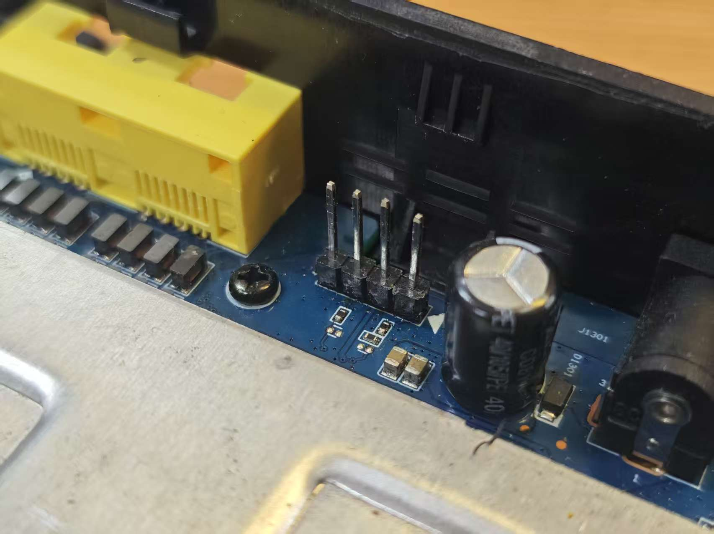
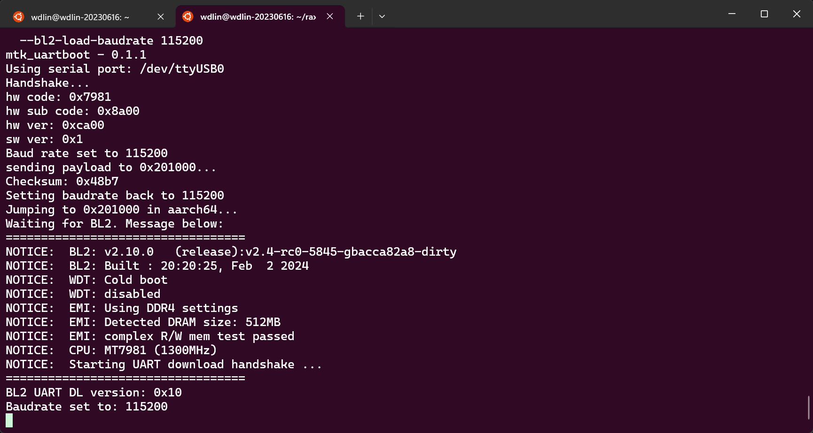

## 原厂系统

最近读一些关于网络架构、DPU 和虚拟化的论文, 发现自己对网络设备完全缺少**直观**的认识, 実は自己本科学的最差的专业课就是计网了, 虽然同学们吐槽说这应该是教的不好.

于是在 `@Siriuns` 的帮助下在海鲜市场购买了 CMCC RAX3000M (eMMC 64GB 版本, CH EC), 第一步是先刷掉原有的移动系统. 整个过程有点熟悉又有点陌生, 原来自己对 Embedded Linux 也不是一点经验没有嘛, 想起之前 OS 比赛上板也用到了类似的知识.

买来的是原厂的系统, RAX3000M 默认固件也不开放 SSH 服务, 在用网线连上后登录路由器管理后台, 据说可以根据修改配置备份文件开启 Dropbear SSH, 但是试过不行. 我得设备生产日期是 2024-10-17, 固件版本 `RAX3000M-MTK.ZD.01`, 导出接口始终返回 `result: -1, failreason: "cmapd exception"`. 似乎有一些生成 SN 派生密码等等的神秘方法, 但我试了没成功, 也不算太了解此处就略过. 总之我决定通过串口刷 OpenWrt.

## 刷机 OpenWrt

整个过程差不多是这样:

1. 拆开路由器, 使用 3.3V USB-TTL 适配器连接 UART
2. 通过 MediaTek BootROM 加载临时启动程序, 进入 U-Boot
3. 通过 U-Boot 加载 initramfs, 进入临时系统 OpenWrt
4. 安装 OpenWrt, 写入启动文件和 GPT 分区表等等

整个过程是先上电, 启动 SoC 内部固化的 BootROM 代码, 然后是 BL2 初始化 DDR 等硬件, 所以后续要根据 DDR3/DDR4 进行选择; 之后是 FIP (Fireware Image Package) 一种固件容器, 包含 BL31 和 U-Boot 等固件组件. 启动 Bootloader (U-Boot) 后才是初始化网络等我们后续熟悉的操作. 不过这些不太懂也不影响一步步刷下来...

### 设备连接

需要准备的硬件:

1. 3.3V USB-TTL 串口适配器, 借的同学的 CH340
2. 三根杜邦线
3. 一根网线, 但多备几根后续折腾也不错

首先呢进行一个路由器的拆, 用平头螺丝刀撬开后盖, UART 测试点如下:



这里是已经焊上排针的情况, 一般来说直接看到的是四个焊点才对.

可以用万用表测量这几个引脚各自谁是 VCC, GND, TXD, RXD. 不过网上也有人已经测好了. USB-TTL 的 GND 与 RAX3000M 的 GND 相连接, 然后 TXD 连 RXD, RXD 连 TXD (也就是逻辑上他们是交叉的), VCC 不连. 这里感谢 `@Fridemn` 帮焊接苦手的我焊了排针, 会更稳定些.

在路由器断电, 杜邦线连接并且 USB-TTL 插入电脑的情况下打开串口终端:

```shell
sudo picocom -b 115200 /dev/ttyUSB0
```

然后给路由器通电观察是否出现 U-Boot 启动日志. 如果是在 WSL2 里, 尽管 USB-TTL 被 Windows 识别但还是需要 `usbipd-win` 之类的配置一下映射传给 WSL. 正常的话应该会显示:

```shell
[mapd][mtk_get_inf_ipv4_addr] failed to get the ip addr of eth1
[   60.909475] 7981@C08L3,APMlmePeriodicExec()
```

### 进入 U-Boot

需要下载 [`mtk_uartboot`](https://github.com/981213/mtk_uartboot), 在 host 端 clone 下来用 `cargo` 构建. 构建后运行:

```shell
sudo ~/mtk_uartboot/target/release/mtk_uartboot \
  --aarch64 \
  --serial /dev/ttyUSB0 \
  --payload ~/rax3000/recovery/bl2-ram.bin \
  --fip ~/rax3000/recovery/fip-debrick.bin \
  --brom-load-baudrate 115200 \
  --bl2-load-baudrate 115200
```

这里的 `.bin` 与 `fip` 文件等要根据 [OpenWrt 25.12.6 官方固件目录](https://downloads.openwrt.org/releases/25.12.6/targets/mediatek/filogic/), 选择合适的文件, 这里我的设备对应 DDR3/DDR4, 所以你得根据 BL2 日志实际看一下 DRAM 类型然后下载:

```shell
NOTICE: EMI: Using DDR4 settings
NOTICE: EMI: Detected DRAM size: 512MB
NOTICE: CPU: MT7981 (1300MHz)
```

下载下来 `mt7981-ddr4-bl2-ram-boot.bin`	是用于初始化 DDR4 的, 通过 UART 临时启动.	`mt7981_cmcc_rax3000m-emmc-fip-debrick-only_20241010.bin`	是用来救援 U-Boot 的. 这个过程就是使用社区的组合, 通过 UART 把 U-Boot 放到 RAM 中.

运行 `mkt_uartboot` 后显示 `Handshake...`, 然后接通路由器电源. 此时 BootROM 接受 BL2, BL2 完成 DDR4 初始化, 再通过 UART 接受 FIP. 进入 RAM 中的 U-Boot.



等一会会显示 `FIP sent`. 此时 BL2 和 FIP 都通过 UART 传输完成. 

```shell
FIP sent.
NOTICE: Received FIP 0x90385 @ 0x40400000 ...
```

### initramfs

访问 `http://192.168.1.1`, 进入 FIREWARE UPDATE, 尝试进入临时 OpenWrt, 上传之前下载的 `openwrt-25.12.6-mediatek-filogic-cmcc_rax3000m-initramfs-recovery.itb`. 之后浏览器的 U-Boot 界面会断开连接, 然后就应该可以 ssh 连接上路由器了.

连上后检查一下:

```shell
cat /etc/openwrt_release
cat /proc/cmdline
free -h
cat /proc/partitions
blkid
```

此处我发现:

```shell
root@OpenWrt:~# ls -l /dev/mmcblk0*
ls: /dev/mmcblk0*: No such file or directory
```

与 AI 进行友好讨论后发现, 社区的 debrick-only FIP 缺少 FIT Overlay 功能, 只加载了基础 DTB, Linux 中的 eMMC 控制器仍然 disable. 设备的 DBTO 是没问题的. 主要是通过手动指定 eMMC Overlay 的方法进行验证: 

```shell
MT7981> bootm 0x46000000#config-1#mt7981b-cmcc-rax3000m-emmc`
```

```shell
config with overlays but CONFIG_OF_LIBFDT_OVERLAY not set
Could not find a valid device tree
```

<!-- 官方 OpenWrt 的 `initramfs-recovery.itb` 是一个 FIT（Flattened Image Tree）镜像。使用 U-Boot 的 `iminfo` 可以看出其中包含：

```text
kernel-1
initrd-1
fdt-1                              # 基础 Device Tree
fdt-mt7981b-cmcc-rax3000m-emmc    # eMMC Overlay
fdt-mt7981b-cmcc-rax3000m-nand    # NAND Overlay
```

最初救援 U-Boot 默认使用 `config-1`，只加载了基础 DTB，因此 Linux 中的 eMMC 控制器依然是 disabled。

通过 Tftpd64 将镜像放到 Windows 电脑，随后在救援 U-Boot 里运行 TFTP：

```text
MT7981> tftpboot 0x46000000 openwrt-25.12.6-mediatek-filogic-cmcc_rax3000m-initramfs-recovery.itb
MT7981> iminfo 0x46000000
```

试图手动指定 eMMC Overlay：

```text
MT7981> bootm 0x46000000#config-1#mt7981b-cmcc-rax3000m-emmc
```

但是出现：

```text
config with overlays but CONFIG_OF_LIBFDT_OVERLAY not set
Could not find a valid device tree
```

至此原因明确：**不是固件缺少 eMMC DTBO，而是这套社区 debrick-only U-Boot 没有启用合并 Overlay 所需的构建选项。** -->

所以沿用 UART DDR4 RAM BL2, 将 FIP 换成官方 OpenWrt 25.12.6 的 eMMC DDR4 版本:

```shell
sudo ~/mtk_uartboot/target/release/mtk_uartboot \
  --aarch64 --serial /dev/ttyUSB0 \
  --payload ~/rax3000/recovery/bl2-ram.bin \
  --fip ~/rax3000/recovery/fip-official-ddr4.bin \
  --brom-load-baudrate 115200 \
  --bl2-load-baudrate 115200
```

进入官方 U-Boot 后出现:

```shell
ver=U-Boot 2025.10-OpenWrt-r33311-981c978eff
bootconf=config-1#mt7981b-cmcc-rax3000m-emmc
loadaddr=0x46000000
serverip=192.168.1.254
bootfile=openwrt-mediatek-filogic-cmcc_rax3000m-initramfs-recovery.itb
boot_tftp=tftpboot $loadaddr $bootfile && bootm $loadaddr#$bootconf
```

随后执行:

```shell
MT7981> run boot_tftp
```

从网络加载临时固件, Linux 日志出现:

```shell
mmc0: new MMC card at address 0001
mmcblk0: mmc0:0001 SCA64G 58.2 GiB
mmcblk0: p1 p2 p3 p4 p5 p6 p7 p8 p9 p10 p11 p12
mmcblk0boot0: mmc0:0001 SCA64G 4.00 MiB
```

在 OpenWrt 中再次检查 `/proc/device-tree/soc/mmc@11230000/status`, 结果是 `okay`. 由此硬件层面的障碍解决.

### 写入 eMMC

验证可以正常识别 eMMC 后基本没什么问题了, 进行原厂固件备份后就可以开始刷, 先写入官方 GPT 开始真正修改 eMMC:

```shell
dd if=openwrt-25.12.6-mediatek-filogic-cmcc_rax3000m-emmc-gpt.bin \
   of=/dev/mmcblk0 bs=512 count=34 conv=fsync
```

然后写位于 eMMC 硬件 Boot0 区域的 DDR4 BL2,

```shell
echo 0 > /sys/block/mmcblk0boot0/force_ro
dd if=/dev/zero of=/dev/mmcblk0boot0 bs=512 count=8192 conv=fsync
dd if=openwrt-25.12.6-mediatek-filogic-cmcc_rax3000m-emmc-ddr4-preloader.bin \
   of=/dev/mmcblk0boot0 bs=512 conv=fsync
echo 1 > /sys/block/mmcblk0boot0/force_ro
```

似乎没什么太特别的, 就一些 Boot0 写保护之类.

写 DDR4 FIP, FIP 位于主 eMMC 用户区域, 从 LBA 13312 开始, 官方 GPT 预留 8192 个扇区:

```shell
dd if=/dev/zero of=/dev/mmcblk0 bs=512 seek=13312 count=8192 conv=fsync
dd if=openwrt-25.12.6-mediatek-filogic-cmcc_rax3000m-emmc-ddr4-bl31-uboot.fip \
   of=/dev/mmcblk0 bs=512 seek=13312 conv=fsync
```

`dd` 的 `seek` 是相对于输出目标的偏移, 单位由 `bs` 决定. 这里如果省略 `seek=13312`, 就可能从磁盘开头破坏 GPT. 

然后可以 `sync`, 进行写入校验之类. 这里其实就差不多了, 独立冷启动试试:

```shell
root@OpenWrt:~# cat /proc/partitions
major minor  #blocks  name
 179        0   61063168 mmcblk0
 179        1        512 mmcblk0p1
 179        2       2048 mmcblk0p2
 179        3       4096 mmcblk0p3
 179        4      32768 mmcblk0p4
 179        5     458752 mmcblk0p5
 259        0       4079 mmcblk0p128
 179        8       4096 mmcblk0boot0
 179       16       4096 mmcblk0boot1
root@OpenWrt:~# cat /tmp/sysinfo/board_name
cmcc,rax3000m
```

差不多就此结束, 不会的问题就 Ask The Friendly AI, 基本都能解决. 不过对整个过程还真说不上太了解, 唉嵌入式很神奇吧.

## 问题

Linux 看不到 eMMC? 因为 Bootloader 交给 Linux 的设备树不完整, MMC 节点处于 `disabled`, 选择并应用 eMMC DTBO 后 Linux 才能初始化.

Boot0 和 GPT 的 p1? `/dev/mmcblk0boot0` 是 eMMC 设备提供的专用硬件启动区域, BL2 / Preloader; `/dev/mmcblk0p1` 是普通用户数据区域中由 GPT 定义的逻辑分区, U-Boot 环境变量. 剩下几个分区是 Factory 校准数据、FIP / U-Boot 等等.